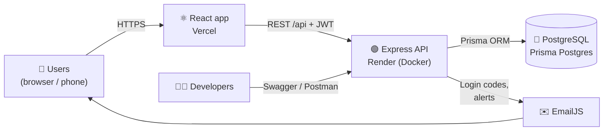
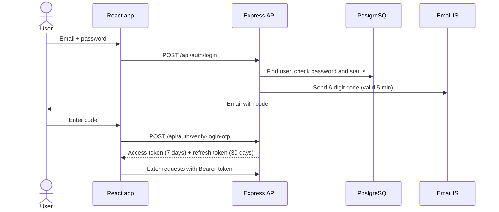
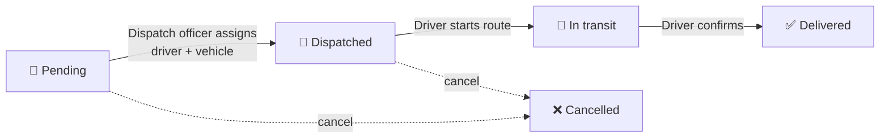

<div align="center">

# 📦 WareTrack-Pro

**Warehouse Delivery & Dispatch Tracking System**

Manage inventory, orders, vehicles, drivers and deliveries in one place, with a dashboard for every role.

[](https://ware-track-pro.vercel.app/)
[](https://waretrack-pro.onrender.com/)
[](https://waretrack-pro.onrender.com/api-docs)
[](./WareTrack-Pro-API.postman_collection.json)


</div>

---

## 📚 Contents

- [What it does](#-what-it-does)
- [Tech stack](#-tech-stack)
- [How the system works](#-how-the-system-works)
- [Roles and permissions](#-roles-and-permissions)
- [Getting started](#-getting-started)
- [Environment variables](#-environment-variables)
- [Deployment](#-deployment)
- [API documentation](#-api-documentation)
- [Security](#-security)
- [Project structure](#-project-structure)
- [What's new in 2.2.0](#-whats-new-in-220)

---

## ✨ What it does

| Area | Highlights |
|---|---|
| 📦 **Inventory** | Stock levels, categories, low-stock and out-of-stock alerts, bulk import, barcodes |
| 🧾 **Orders** | Create orders from live inventory, track each stage from pending to delivered |
| 🚚 **Dispatch** | Assign drivers and vehicles, schedule deliveries, update status on the road |
| 🛻 **Fleet** | Vehicles, maintenance schedules, driver profiles and performance |
| 📍 **Tracking** | Follow every delivery, with a public tracking lookup for customers |
| 📊 **Reports** | Delivery trends, status breakdowns, inventory by category, KPIs; export to PDF, CSV or JSON |
| 🔔 **Notifications** | In-app alerts and email notifications |
| 👥 **Users** | Role-based dashboards, admin approval for new accounts |

---

## 🧰 Tech stack

### Frontend


### Backend


### Services and tooling


| Layer | Technology | Purpose |
|---|---|---|
| UI | React 18, TypeScript, Tailwind CSS, Space Grotesk font | Role-based dashboards and forms |
| Charts | Recharts | Trends, distributions and KPIs |
| Data fetching | Axios, TanStack Query | API calls with caching and auto-refresh |
| API | Node.js 18, Express 4 | REST API with 100+ endpoints |
| Data access | Prisma ORM | Type-safe queries and migrations |
| Database | PostgreSQL on Prisma Postgres | Persistent storage |
| Auth | bcrypt, JWT, email OTP | Password + one-time code sign-in |
| Email | EmailJS | Login codes, password resets, alerts |
| Docs | Swagger UI / OpenAPI 3 | Interactive API reference |
| Hosting | Vercel (frontend), Render (API, Docker) | Production deployment |

---

## 🏗 How the system works

### Architecture



1. **The frontend** (React on Vercel) shows each user the dashboard for their role.
2. **The API** (Express on Render) checks every request: valid token, active account, and permission for that role.
3. **Prisma** reads and writes the PostgreSQL database.
4. **EmailJS** sends login codes, password resets and notifications.
5. **A scheduler** checks inventory every 6 hours and raises low-stock and out-of-stock alerts.

### Sign-in flow

Every sign-in needs the password **and** a one-time code sent by email.



### Order lifecycle



---

## 👥 Roles and permissions

| Capability | Admin | Warehouse Staff | Dispatch Officer | Driver |
|---|:-:|:-:|:-:|:-:|
| Manage users, approve new accounts | ✅ | | | |
| System settings | ✅ | | | |
| Add / edit / delete inventory | ✅ | ✅ | | |
| Create / edit orders | ✅ | ✅ | ✅ | |
| Manage vehicles, drivers, dispatches | ✅ | | ✅ | |
| Update delivery status | ✅ | ✅ | ✅ | ✅ |
| Reports and analytics | ✅ | ✅ | ✅ | |
| Own profile and password | ✅ | ✅ | ✅ | ✅ |

These rules are enforced by the API, not only hidden in the interface.

> **New accounts:** the first account ever created becomes the Admin. Everyone who signs up after that starts **inactive**, and an Admin activates them from the Users page.

---

## 🚀 Getting started

### Requirements

- Node.js 18 or newer
- PostgreSQL 14 or newer (local, Docker, or a hosted database)
- An EmailJS account, to receive login codes

### 1. Clone

```bash
git clone https://github.com/manziosee/WareTrack-Pro.git
cd WareTrack-Pro
```

### 2. Backend

```bash
cd backend
npm install
cp .env.example .env        # then fill in your values (see below)
npx prisma generate
npx prisma migrate dev
npm run dev                 # http://localhost:5000
```

Optional sample data for **local development only**:

```bash
npx prisma db seed
```

> ⚠️ The seed creates demo accounts with well-known passwords. Never run it against a production database.

### 3. Frontend

```bash
cd frontend
npm install
echo "VITE_API_URL=http://localhost:5000/api" > .env
npm run dev                 # http://localhost:3001
```

### Docker (alternative)

```bash
docker-compose up -d
```

---

## 🔐 Environment variables

Backend (`backend/.env`; never commit this file):

| Variable | Required | Description |
|---|:-:|---|
| `NODE_ENV` | ✅ | `development` or `production` |
| `PORT` | | Port to listen on (default `8080`, Render uses `5000`) |
| `DATABASE_URL` | ✅ | PostgreSQL connection string |
| `JWT_SECRET` | ✅ | At least 32 random characters. Generate one with `openssl rand -hex 48` |
| `JWT_EXPIRE` | | Access-token lifetime, e.g. `7d` |
| `FRONTEND_URL` | ✅ | Frontend address allowed by CORS, e.g. `https://ware-track-pro.vercel.app` |
| `CORS_ORIGINS` | | Extra allowed origins, comma-separated |
| `EMAILJS_SERVICE_ID` | ✅ | EmailJS service |
| `EMAILJS_TEMPLATE_ID` | ✅ | EmailJS template (subject `WareTrack-Pro: {{title}}`, recipient `{{email}}`) |
| `EMAILJS_PUBLIC_KEY` | ✅ | EmailJS public key |
| `EMAILJS_PRIVATE_KEY` | ✅ | EmailJS private key |
| `API_RATE_LIMIT_PER_15_MIN` | | General per-IP request limit (default `1000`) |

The server **refuses to start in production** if `DATABASE_URL` or `JWT_SECRET` is missing, or if `JWT_SECRET` is shorter than 32 characters.

Frontend (Vercel environment variable):

| Variable | Description |
|---|---|
| `VITE_API_URL` | API base URL, e.g. `https://waretrack-pro.onrender.com/api` |

---

## ☁️ Deployment

| Part | Platform | How |
|---|---|---|
| API | [Render](https://render.com) | Docker web service from `backend/` (see [`render.yaml`](render.yaml)) |
| Frontend | [Vercel](https://vercel.com) | Vite build from `frontend/` |
| Database | [Prisma Postgres](https://www.prisma.io/postgres) | Managed PostgreSQL |

### API on Render

1. **New → Web Service**, connect this repository.
2. **Root Directory:** `backend` · **Runtime:** Docker · **Dockerfile Path:** `./Dockerfile`
3. **Health Check Path:** `/health`
4. Add the environment variables from the table above.
5. Deploy. Every push to `main` redeploys automatically.

Alternatively, create it from the [`render.yaml`](render.yaml) Blueprint. Secrets are left for you to fill in, in the dashboard.

> The free Render plan sleeps after 15 minutes without traffic, so the first request afterwards can take around 50 seconds. The frontend waits up to 75 seconds for it.

### Frontend on Vercel

1. Import the repository and set **Root Directory** to `frontend`.
2. Set `VITE_API_URL` to `https://waretrack-pro.onrender.com/api`.
3. Deploy.

---

## 📖 API documentation

| Resource | Link |
|---|---|
| API info | [waretrack-pro.onrender.com](https://waretrack-pro.onrender.com/) |
| Health check | [/health](https://waretrack-pro.onrender.com/health) |
| Swagger UI | [/api-docs](https://waretrack-pro.onrender.com/api-docs) |
| OpenAPI JSON | [/api-docs.json](https://waretrack-pro.onrender.com/api-docs.json) |
| Postman | [`WareTrack-Pro-API.postman_collection.json`](./WareTrack-Pro-API.postman_collection.json) |

### Using the Postman collection (v2.2.0)

1. Import the collection into Postman.
2. In the collection variables, set `email` and `password`.
3. Run **Authentication → POST auth/login**. A code is emailed to you.
4. Put the code in `otp` and run **POST auth/verify-login-otp**. The tokens are saved for every other request.

Each request's description says which roles may call it.

### Main endpoint groups

| Group | Base path |
|---|---|
| Authentication | `/api/auth` |
| Password reset | `/api/password-reset` |
| Dashboard | `/api/dashboard` |
| Users (admin) | `/api/users` |
| Inventory | `/api/inventory` |
| Orders | `/api/orders` |
| Vehicles | `/api/vehicles` |
| Drivers | `/api/drivers` |
| Dispatch | `/api/dispatch` |
| Notifications | `/api/notifications` |
| Reports | `/api/reports` |
| Analytics | `/api/analytics` |
| Settings | `/api/settings` |
| Advanced features (customer portal, proof of delivery, forecasting, barcodes, chat) | `/api/features` |

---

## 🛡 Security

- **Two-step sign-in:** password plus a 6-digit email code that expires in 5 minutes and is cancelled after 5 wrong tries.
- **Rate limits:** 5 login attempts per 15 minutes and 10 code checks per 5 minutes per IP, plus a general API limit.
- **Role checks on the server** for every create, update and delete.
- **Live account checks:** deactivating a user or changing their role takes effect within 30 seconds, even for tokens already issued.
- **Admin approval** for new sign-ups, which never receive tokens directly.
- **Refresh tokens can't be used as access tokens.**
- **No insecure defaults:** no fallback JWT secret, and the server won't start in production without its required secrets.
- **CORS** limited to the configured frontend address.
- **Helmet** security headers on the API and security headers on the Vercel frontend.
- **Request size limit** of 1 MB, and production errors never expose internal details.
- **Passwords** hashed with bcrypt; at least 8 characters with letters and numbers.
- **Customer portal** requests are limited to the signed-in customer's own orders.

**Keep secrets out of Git.** Put real values only in `.env` (git-ignored) or in your hosting dashboards. If a key is ever committed, regenerate it.

---

## 🗂 Project structure

```
WareTrack-Pro/
├── backend/                  Express API
│   ├── prisma/               Schema, migrations, local seed
│   ├── src/
│   │   ├── config/           Environment checks, Swagger setup
│   │   ├── controllers/      Request handlers
│   │   ├── middleware/       Auth, roles, errors, inventory alerts
│   │   ├── routes/           Endpoint definitions (+ Swagger docs)
│   │   ├── services/         Email, notifications, queues
│   │   └── server.ts         Entry point
│   └── Dockerfile
├── frontend/                 React app
│   └── src/
│       ├── components/       UI kit, charts, forms, layout
│       ├── pages/            Screens and role dashboards
│       ├── services/         API clients
│       └── utils/            Formatting and PDF/CSV/JSON export
├── render.yaml               Render Blueprint for the API
├── docker-compose.yml        Local stack
└── WareTrack-Pro-API.postman_collection.json
```

---

## 🆕 What's new in 2.2.0

**Hosting**
- API moved from Fly.io to **Render**; frontend points to `https://waretrack-pro.onrender.com/api`.
- Root (`/`) and `/api` pages, `/api-docs.json`, and a health check that reports database status.

**Security**
- Role-based permissions enforced on every write endpoint.
- New sign-ups need admin approval and no longer receive tokens directly.
- Account status and role re-checked on each request (30-second cache).
- No fallback JWT secret; startup fails without required secrets.
- CORS limited to the frontend; general API rate limit; 1 MB body limit.
- Customer portal secured; public tracking no longer exposes delivery codes or signatures.
- Stronger password rule (8+ characters with letters and numbers).

**Stability**
- A database hiccup during inventory checks no longer crashes the server.
- SQL query logging is off in production.
- Consistent JSON errors and 404s.

**Design**
- Space Grotesk typography, new charts, redesigned detail pop-ups, branded PDF reports, refreshed landing page.

---

## 🤝 Contributing

1. Fork the repository.
2. Create a branch: `git checkout -b feature/my-feature`.
3. Commit your changes and push the branch.
4. Open a pull request.

---

## 📄 License

MIT. See [LICENSE](LICENSE).

## 👨‍💻 Author

**manziosee**: [github.com/manziosee](https://github.com/manziosee)

<div align="center">

⭐ **Star the repository if you find it useful!**

</div>
